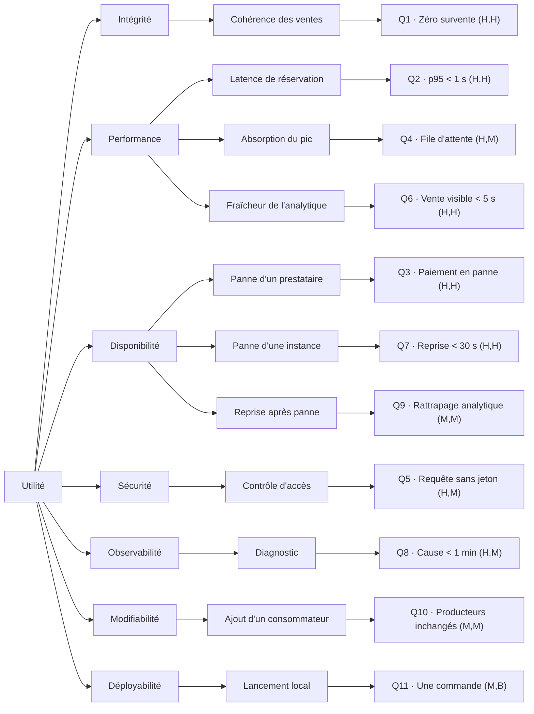

# 10. Exigences de qualité

## Arbre d'utilité

## Scénarios de qualité

Priorité notée (Importance pour le métier, Difficulté technique), chacune Haute, Moyenne ou Basse. Les scénarios (H,H) guident l'architecture.

| #   | Attribut      | Scénario                                                                        | Mesure                                                                                                                           | Priorité | Vérification                                   |
|-----|---------------|---------------------------------------------------------------------------------|----------------------------------------------------------------------------------------------------------------------------------|----------|------------------------------------------------|
| Q1  | Intégrité     | 50 000 acheteurs tentent de réserver les 5 000 places au même moment            | 0 place vendue deux fois, billets vendus ≤ 5 000                                                                                 | (H,H)    | Test de charge k6 et contrôle en base          |
| Q2  | Performance   | Pendant le pic, un acheteur admis réserve une place                             | p95 < 1 s, moins de 1 % d'erreurs serveur                                                                                        | (H,H)    | Seuils k6                                      |
| Q3  | Disponibilité | Le prestataire de paiement échoue ou ne répond plus pendant la vente            | 0 place perdue ni vendue deux fois, places libérées à l'expiration de la réservation temporaire, le reste du parcours fonctionne | (H,H)    | Injection de panne sur le prestataire simulé   |
| Q4  | Performance   | 50 000 acheteurs arrivent dans la file d'attente en une minute                  | Position affichée en moins de 2 s (p95), admission dans l'ordre d'arrivée                                                        | (H,M)    | Test de charge k6                              |
| Q5  | Sécurité      | Une requête de réservation arrive sans jeton valide                             | 100 % refusées par la passerelle (401) avant d'atteindre le service                                                              | (H,M)    | Test automatisé en CI                          |
| Q6  | Performance   | Une vente est confirmée pendant le pic                                          | Visible sur le tableau de bord de l'organisateur en moins de 5 s (p95)                                                           | (H,H)    | Métrique de délai de bout en bout dans Grafana |
| Q7  | Disponibilité | Une instance du service de réservation s'arrête pendant la vente                | La vente reprend en moins de 30 s, aucune réservation confirmée perdue                                                           | (H,H)    | Injection de panne (arrêt du conteneur)        |
| Q8  | Observabilité | Une panne est injectée pendant la démonstration                                 | Le service en cause est identifié en moins d'une minute                                                                          | (H,M)    | Tableau de bord et traces, en soutenance       |
| Q9  | Disponibilité | Le service d'analytique redémarre après une panne                               | Il rattrape son retard depuis Redpanda, compteurs identiques à ceux de la réservation                                            | (M,M)    | Comparaison après redémarrage                  |
| Q10 | Modifiabilité | Un nouveau consommateur d'événements est ajouté (par exemple des notifications) | Aucune modification des services producteurs                                                                                     | (M,M)    | Fonction de fitness sur les dépendances        |
| Q11 | Déployabilité | Un membre lance le projet sur un poste neuf                                     | Tous les services prêts en moins de 5 min avec une seule commande, hors téléchargement des images                                | (M,B)    | Job « Infrastructure » de la CI                |

## Détail des scénarios moteurs

### Q1 — Zéro survente
- **Source** : 50 000 acheteurs virtuels (k6)
- **Stimulus** : demandes de réservation simultanées sur les mêmes places
- **Artefact** : service de réservation et sa base de données
- **Environnement** : ouverture de la vente, charge maximale
- **Réponse** : chaque place est attribuée au plus une fois ; les demandes perdantes reçoivent un refus explicite
- **Mesure** : 0 place attribuée deux fois, billets vendus ≤ 5 000

### Q2 — Latence de réservation
- **Source** : acheteurs admis par la file d'attente
- **Stimulus** : demande de réservation d'une place
- **Artefact** : passerelle et service de réservation
- **Environnement** : pic de la mise en vente
- **Réponse** : la place est réservée temporairement ou refusée
- **Mesure** : p95 < 1 s, moins de 1 % d'erreurs serveur

### Q3 — Panne du prestataire de paiement
- **Source** : prestataire de paiement simulé
- **Stimulus** : erreurs ou absence de réponse pendant la vente
- **Artefact** : saga de réservation et de paiement
- **Environnement** : vente en cours, charge normale à forte
- **Réponse** : les paiements en échec déclenchent la compensation ; les places réservées sont libérées à l'expiration ; la file et le catalogue continuent de fonctionner
- **Mesure** : 0 place perdue, 0 place vendue deux fois

### Q6 — Fraîcheur de l'analytique
- **Source** : service de réservation
- **Stimulus** : confirmation d'une vente
- **Artefact** : flux d'événements et service d'analytique
- **Environnement** : pic de la mise en vente
- **Réponse** : la vente est comptée et affichée sur le tableau de bord de l'organisateur
- **Mesure** : délai entre la confirmation et l'affichage < 5 s (p95)

### Q7 — Panne d'une instance
- **Source** : comité, pendant la soutenance
- **Stimulus** : arrêt brutal d'une instance du service de réservation
- **Artefact** : service de réservation
- **Environnement** : vente en cours
- **Réponse** : le trafic bascule sur les instances restantes ; les réservations en cours sont reprises ou expirent proprement
- **Mesure** : la vente reprend en moins de 30 s, aucune réservation confirmée perdue